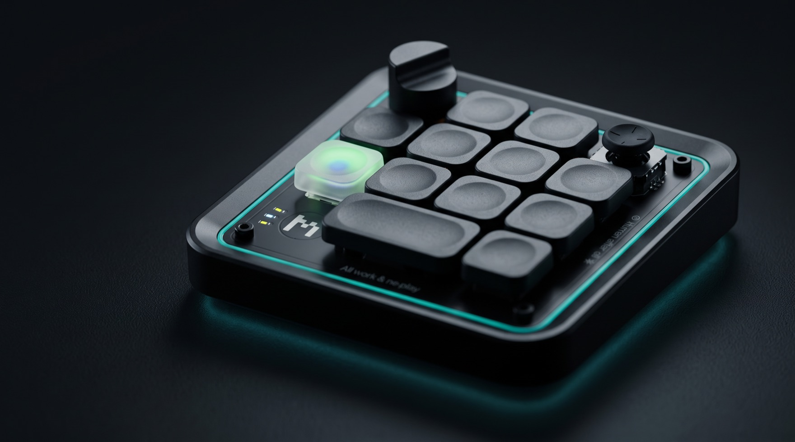

# Paseo Micro



Paseo Micro connects a Work Louder Creator Micro 2 keypad to
[Paseo](https://paseo.sh) agents.
A Swift menu bar app handles USB, lights, and macOS shortcuts.
A [Paseo plugin](Plugin/) maps keys, dial, and joystick to agent actions.

The USB HID protocol is documented by
[micro-manager](https://github.com/schacon/micro-manager)
and [creator-micro-kit](https://github.com/00cyre/creator-micro-kit).

## Install

- macOS 15 or later and a Creator Micro 2 connected over USB.
- [Paseo 0.13.0 or later](Plugin/paseo-plugin.json), with plugins enabled.
- Swift 6.2 or later and Xcode 26 or later, selected as the active developer tools.
  The build needs `xcrun actool` to compile `App/AppIcon.icon`;
  Command Line Tools alone are not sufficient.
- [mise](https://mise.jdx.dev/) for the repository's tasks and Node.js version.
- An Apple Development certificate in your keychain to sign the app.

Clone and set up the repository:

```sh
git clone https://github.com/mattt/paseo-creator-micro.git
cd paseo-creator-micro
mise install
```

Find your signing certificate's full name:

```sh
security find-identity -v -p codesigning
```

Set `PASEO_MICRO_SIGNING_IDENTITY` to that name in your shell
or in the Git-ignored `mise.local.toml`:

```toml
[env]
PASEO_MICRO_SIGNING_IDENTITY = "<your Apple Development certificate name>"
```

Use the same certificate for rebuilds so macOS can keep permissions.

Build and install the app:

```sh
mise run build:app     # Build and sign build/PaseoMicro.app.
mise run install:app   # Rebuild, install /Applications/Paseo Micro.app, and open it.
```

Installation quits running copies and replaces the installed app.
The app enables Launch at Login on its first run from an Applications folder;
you can turn it off in the menu.
Approve it in System Settings > General > Login Items & Extensions if asked.

In System Settings > Privacy & Security, enable **Paseo Micro** under
**Accessibility** for keyboard shortcuts, scrolling, and Escape on the radial menu.
Also enable **Input Monitoring** if the menu says Escape needs that permission.

Install the plugin:

```sh
paseo plugin add git:mattt/paseo-creator-micro:Plugin
```

Open Paseo and **Settings > Plugins > Creator Micro > Keypad**.
Opening the settings gives the plugin a daemon connection.
Quit the ChatGPT app to prevent it from acting on the same keypad inputs.

The menu shows the keypad's status, only the warnings that you can act on,
and a drawing of the keypad whose lights follow the lights that the app keeps on it.
The app does not read lights back from the keypad,
and it shows the keypad's effects without matching their timing.
The header always shows how the keypad is connected, over USB or Bluetooth, and its battery charge.
Hold Option as it opens, or while it is open, to see each key's number
(1 to 13, as in the plugin's settings),
the firmware, layer, lighting, last input, connected programs, and the MCP address.
A dashed outline marks a key that has no light of its own on the current layer.

### Keypad layers and experimental features

Switch to the stock "ChatGPT" layer (layer 4) for keys and dial.
Paseo Micro finds input layers by reading `KV_OAI_` codes in `keymap.json`;
other layers show a warning and cannot control Paseo.

**The joystick radial menu and key 7's individual light need a custom keypad
layer 2.**
There is no supported setup tool yet.
The stock layer 4 sends no joystick events on firmware 0.6.3.

Writing a keymap can leave the keypad needing a reflash.
Work Louder's Input app may rewrite a custom layer.
Paseo Micro itself never writes the keypad's files.
With the stock layer, key 7 still opens the next agent and the underglow shows its state.

## Keys and default bindings

Keys are numbered 1 to 13, as in the menu and the plugin's settings.
Firmware codes such as `ACT06` count from 0, so key 7 is `ACT06`;
the bridge, MCP, and logs also use 0-based indexes.
The rows contain 2, 4, 4, and 3 switches,
and keys 11 and 12 share one double-wide keycap:

```text
       [1] [2]
   [3] [4] [5] [6]
   [7] [8] [9] [10]
     [ 11–12 ] [13]
```

| Input | Default action |
| --- | --- |
| Key 1, `AG00` | Back through agents opened with the keypad |
| Key 2, `AG01` | Forward through that history |
| Key 3, `AG02` | Previous project |
| Key 4, `AG03` | Previous workspace (`Cmd+[`) |
| Key 5, `AG04` | Next workspace (`Cmd+]`) |
| Key 6, `AG05` | Next project |
| Key 7, `ACT06` or `AG06` | Open the next agent that needs action |
| Key 8, `ACT07` | Approve a permission request |
| Key 9, `ACT08` | Deny a permission request |
| Key 10, `ACT09` | Start a new agent (`Cmd+O`) |
| Keys 11–12, `ACT10` and `ACT11` | Push to talk, as one double-wide keycap |
| Key 13, `ACT12` | Submit |
| Dial clockwise / counterclockwise | Scroll down / up, 3 lines per step |
| Held dial clockwise / counterclockwise | Scroll down / up, 15 lines per step |
| Dial click | Jump to the bottom of the conversation |
| Joystick | Radial menu, on the custom layer described above |

Push to talk starts dictation with `Cmd+D` on press and stops on release,
sending Return only if enabled.
Submit stops active dictation before sending Return.
No input toggles voice mode by default.
The shared keycap acts from its first switch closing to its last switch opening.
Change key groups if your keycaps differ.

The radial choices, clockwise from up, are Back, Test, Continue, Commit, Forward,
Review, Stop, and Summary.
Test, Continue, Commit, Review, and Summary send configurable prompts.
Push the stick toward a choice and let it spring back to select it.
Return slowly to the center to cancel.
Escape, a keypad key, or a dial press also cancels without running another action.
With the radial menu off, the four directions send separate prompts, initially empty.

Key 7 cycles through agents that need action, longest waiting first,
without repeating an agent until the round ends.
The underglow and, on the custom layer, key 7 show the next agent's state:
red for failure, breathing yellow for input, green for an unread result, and off for none.
Subagents are excluded unless **Include subagents** is enabled.

## Configuration

Open **Settings > Plugins > Creator Micro** or
**Creator Micro: open keypad settings** in Command Center.
The settings show a picture of the keypad, numbered 1 to 13, whose lights follow the real unit.
Below it, rows in key order assign each key's action, the dial's gestures, and radial choices;
choosing a part in the picture highlights its row.
Double-wide keycaps are under Advanced.
Settings control lighting, scrolling, push-to-talk submission, and subagent inclusion.
Without a selected workspace, actions target the next agent that needs action,
else the most recently active agent; this is configurable.
Invalid settings disable actions until fixed or reset.

The top six keys can use Navigation (the default), Recent agents, Workspaces,
Pinned workspaces, or Off.
Recent agents mode selects on one tap and opens on a double tap,
unless **Open on a single tap** is enabled.
See [the plugin README](Plugin/README.md) for workspace selection,
state colors, and all actions and settings.

Command Center commands pin or unpin workspaces on keys 1-6 and reconnect to the app.
The composer commands `/keypad-pin-workspace <1-6>` and `/keypad-unpin-workspace`
also manage pins.
The sidebar footer shows, in Paseo's words, the state of the agent that key 7 opens next,
such as "Needs input", with a dot in that state's light color;
it says "Keypad ready" when nothing needs action, and dims when the keypad does not work.
Click it for the agent's name, a live picture of the keypad with a numbered list of what each key does,
the top-key mode, the underglow, and the full settings.

`mise run run:app` passes these environment variables to the app:

| Variable | Effect |
| --- | --- |
| `PASEO_MICRO_EMULATED=1` | Use the emulated keypad, with its controls in the menu |
| `PASEO_MICRO_MCP_PORT` | Override port 7655, or the `mcpPort` user default |
| `PASEO_MICRO_BRIDGE_SOCKET` | Override the bridge socket path |

Set the same socket path in the plugin's Advanced settings if you change it.
The plugin runs `paseo` from `PATH`, else from
`/Applications/Paseo.app/Contents/Resources/bin/paseo`, unless you set its path.
It runs the CLI with arguments, without a shell.

## How it works

```text
Creator Micro 2 -> PaseoMicro.app -> Unix socket -> Paseo plugin -> Paseo daemon
                         |
                         +-> MCP over HTTP on 127.0.0.1
```

The app reconnects after unplug and sleep and restores lights.
The plugin reads agent state, updates lights, and handles inputs through the local
app socket and Paseo CLI, with no network connections.
Selection survives plugin reloads but is lost when both app and plugin restart.

### Plugin API limits

Paseo 0.13 does not report the window's workspace to plugins.
Back and forward track only places opened with the keypad, up to 50;
workspace shortcuts do not update history.
Projects are ordered by name.
There is no supported plugin API for changing an existing agent's model or forking it.
Dial clicks use a bounded scroll burst; clicks during a pending jump are ignored.
Upward bursts caused Paseo's conversation list to crash and have no default binding.

### Bridge and MCP

The bridge serves newline-delimited JSON on
`~/Library/Application Support/PaseoMicro/bridge.sock` (socket mode 0600,
parent folder mode 0700).
[BridgeProtocol.swift](Sources/PaseoMicroCore/BridgeProtocol.swift) and
[bridge-protocol.ts](Plugin/server/bridge-protocol.ts) define protocol version 1.

The stateless Streamable HTTP MCP server listens only on loopback at
`http://127.0.0.1:7655/mcp`.
It provides `get_keypad_state`, `set_key_lights`, `set_zone_lights`, `clear_lights`,
and `wait_for_input`.
Lighting requests are previews and do not save keypad files.
The bundled `micro` command is another bridge client:

```sh
build/PaseoMicro.app/Contents/MacOS/micro state
build/PaseoMicro.app/Contents/MacOS/micro watch
build/PaseoMicro.app/Contents/MacOS/micro lights 0=#FF2D2D,breathing 1=#00FF00,solid,0.5
build/PaseoMicro.app/Contents/MacOS/micro zones --keys '#FFFFFF,solid,0.3' --ambient '#2D7DFF'
build/PaseoMicro.app/Contents/MacOS/micro clear
```

## Troubleshooting

- If keys do nothing, check that the app is connected, the keypad is on an input layer,
  and Paseo has connected to the plugin.
  Open the plugin settings and check the sidebar footer for errors.
- If lights pause, hold Option while the app's menu is open and check Lighting.
  While ChatGPT runs, Paseo Micro pauses writes on the layer named "ChatGPT"
  (layer 4 if no name is found).
  On other input layers it repaints every 30 seconds because ChatGPT resets lights.
- If key 7 has no individual light or the joystick does nothing, read
  [the custom layer limits](#keypad-layers-and-experimental-features).
- If shortcuts or scrolling fail, check Accessibility permission.
  If permission is already enabled, turn it off and on again.
  If Escape cannot cancel the radial menu, follow the menu's Input Monitoring warning.
- If scrolling reaches the wrong part of Paseo, adjust its position in Scrolling settings.
- If the bridge cannot start, the app's menu says so.
  Hold Option while the menu is open to see the bridge or MCP error in Details.
  Check for another app instance or an occupied port.
  The app refuses to replace a socket path that contains an ordinary file.

With `PASEO_MICRO_EMULATED=1`, click a key in the menu or use its dial and joystick controls.

## Development

`Sources/CreatorMicro/` contains the HID protocol, transport, and emulated keypad.
`Sources/PaseoMicroCore/` contains the keypad session, lighting, bridge, and MCP server.
`Sources/PaseoMicro/` is the menu bar app and `Sources/PaseoMicroMenu/` its menu's views;
`Sources/micro/` is the bridge client.
`Tests/` contains the Swift tests, `App/` contains the bundle metadata and icon,
`Scripts/app.sh` builds and signs the app, and `Plugin/` contains the Paseo plugin.

The menu bar uses template PDFs in `Sources/PaseoMicro/Resources/`.
The disconnected state uses the connected image at 40 percent opacity;
the attention state adds an exclamation mark.
Run `mise run generate:icons` from the repository root to regenerate them
and render each state at 1x and 2x on light and dark backgrounds
in `/tmp/paseo-micro-icons/`.
Use Xcode's Swift toolchain, as for the build tasks.
The app build copies the SwiftPM resource bundle into the app before signing it.

Document every public Swift symbol.
Run `mise run check` before each commit.
Only one program may write to the keypad's vendor HID interface at a time.
Keep `KeypadClient` limited to `fs.list` and `fs.read` for file access:
writing or deleting keypad files can leave it unusable until it is reflashed.
Lighting previews do not save files on the keypad.

Paseo compiles the TypeScript plugin; there is no separate plugin build step.

```sh
mise run install:plugin       # Install plugin development dependencies from the lockfile.
mise run check                # Check Swift and the plugin.
mise run render:menu          # Render the menu's sample states to build/menu-previews/.
mise run check:swift          # Lint, build, and test Swift.
mise run check:plugin         # Check plugin format, lint, types, and tests.
mise run format:swift         # Format Swift sources.
mise run format:plugin        # Format plugin sources.
mise run run:app              # Open the installed app, else the build.
mise run run:app -- build     # Open the build even if an installed copy exists.
mise run quit:app             # Quit any running copy.
```

If your shell selects a separate toolchain, switch to Xcode's Swift compiler
and matching SDK before running tasks.
Tests use the emulated keypad, temporary sockets, and system-chosen ports.
Hardware tests are opt-in with `PASEO_MICRO_HARDWARE=1 mise run test:swift`;
they use read-only calls and lighting previews.
Do not run them while another program writes to the keypad's vendor HID interface.
For plugin development, install a local checkout and reload it with
`paseo plugin install "$PWD/Plugin"` and `paseo plugin reload creator-micro`.
See [plugin development](Plugin/README.md#development) for the fake bridge and logs.

## License

MIT; see [LICENSE.md](LICENSE.md).
